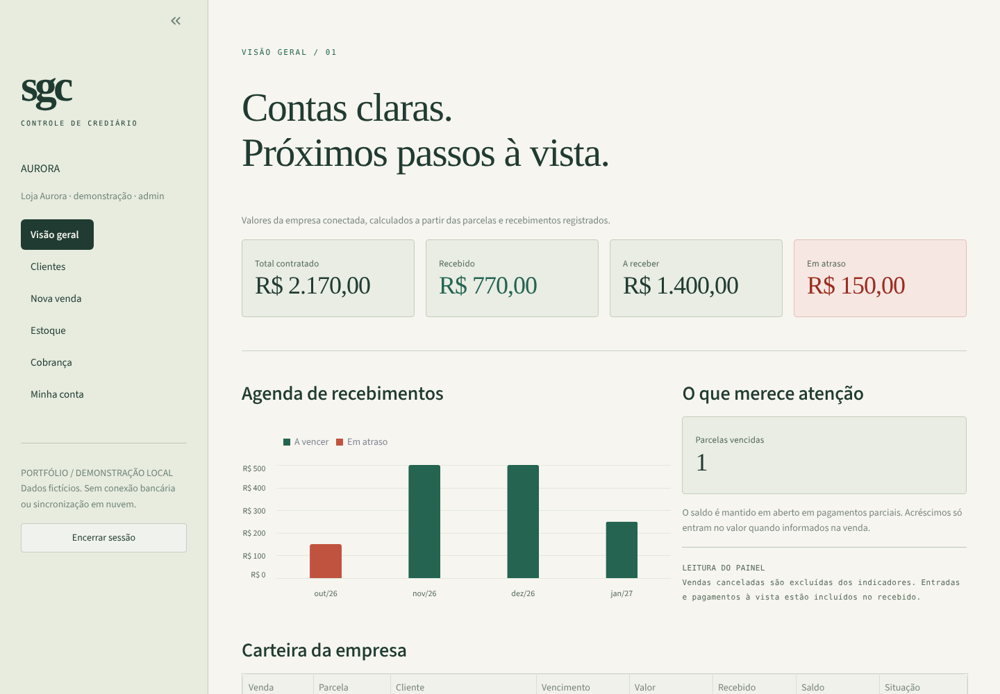
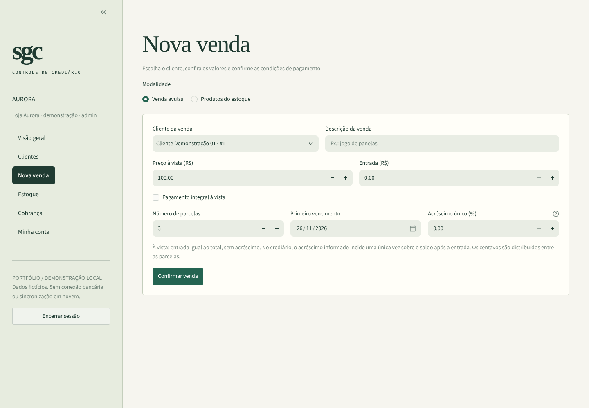
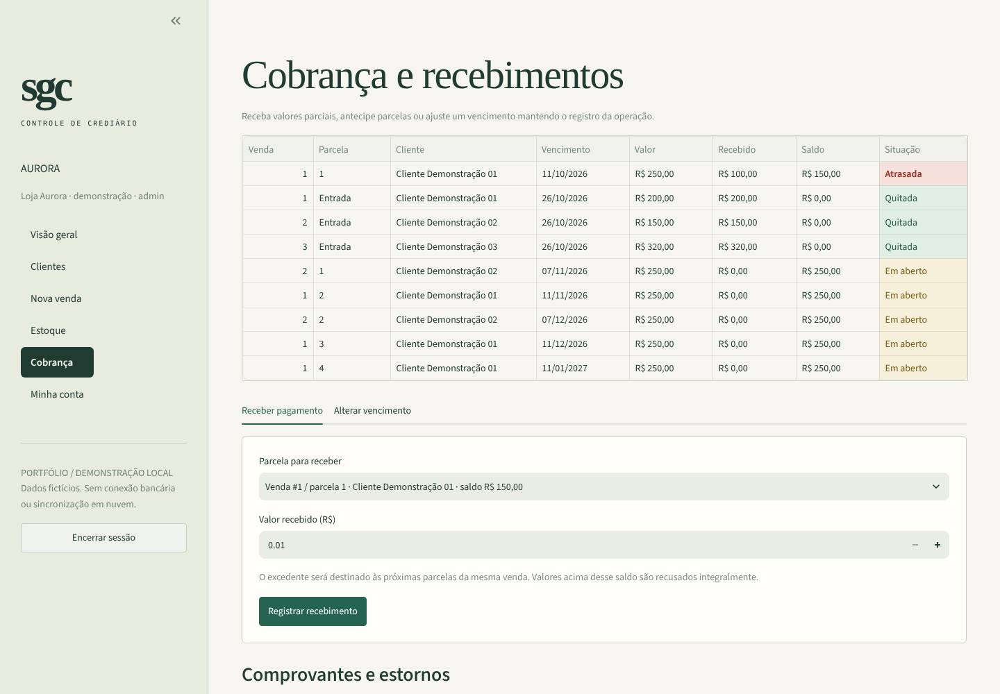
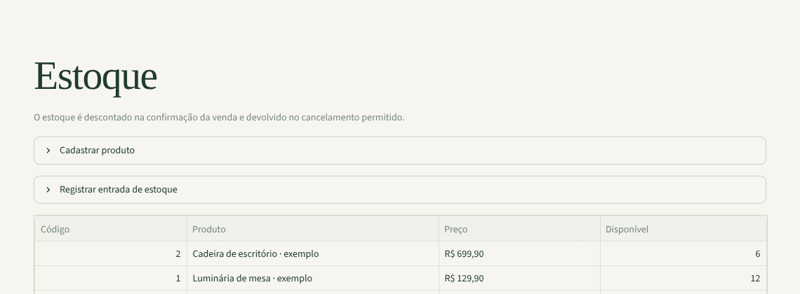
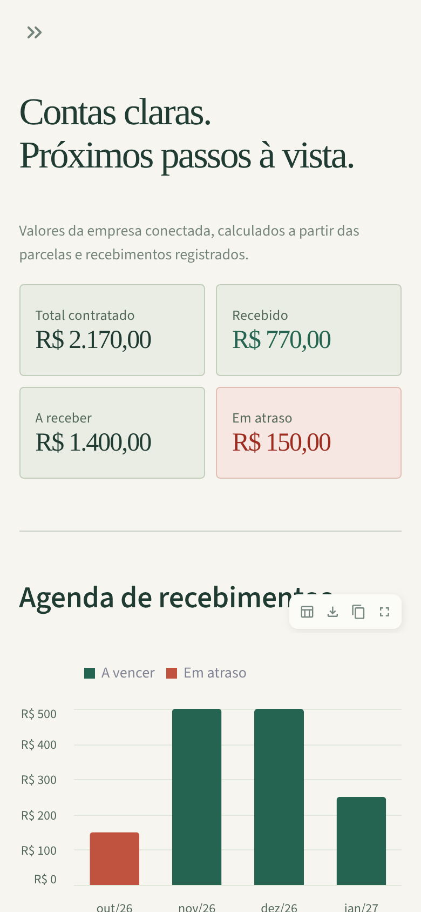

<div align="center">

# SGC · Crediário

**Cada parcela, uma história bem registrada.**

Vendas, estoque e recebimentos parcelados em uma aplicação local em Python, com permissões por
perfil, dados separados por empresa e valores calculados em centavos.

[](https://github.com/alex10presam-lang/sgc-crediario-Python/actions/workflows/tests.yml)


[Executar](#executar-localmente) · [Roteiro](#um-roteiro-para-explorar) · [Arquitetura](docs/architecture.md) · [Testes](#qualidade-e-testes)

</div>



<sub>Captura da aplicação em execução. Empresas, clientes, produtos e valores são fictícios.</sub>

## O projeto

O SGC organiza uma rotina de crediário: cadastrar um cliente, registrar uma venda, dividir o saldo e acompanhar cada recebimento. A interface destaca o que já entrou, o que ainda falta receber e quais parcelas venceram.

Esta edição foi preparada para portfólio a partir do projeto original. As regras financeiras e de acesso foram separadas das telas, com uma base nova de demonstração e testes de regressão. Os bancos antigos não são importados automaticamente.

| Área | Funcionalidades |
| --- | --- |
| Clientes | Cadastro e consulta por empresa |
| Vendas | Venda avulsa ou com produtos, entrada, pagamento à vista e parcelamento |
| Estoque | Cadastro, reposição, baixa na venda e devolução no cancelamento permitido |
| Cobrança | Pagamento parcial, distribuição do excedente e alteração de vencimento |
| Comprovantes | PDF com valor recebido e destino nas parcelas |
| Administração | Perfis de acesso, desativação de contas e auditoria |

## Executar localmente

Requer **Python 3.12** e Git. Os comandos abaixo partem da pasta do projeto.

```bash
git clone https://github.com/alex10presam-lang/sgc-crediario-Python.git
cd sgc-crediario-Python
python -m venv .venv
```

Ative o ambiente:

```powershell
# Windows / PowerShell
.\.venv\Scripts\Activate.ps1
```

```bash
# Linux / macOS
source .venv/bin/activate
```

Instale as dependências, prepare os exemplos e inicie:

```bash
python -m pip install -r requirements.txt
python -m sgc.demo
python -m streamlit run dashboard.py --server.address=127.0.0.1
```

Abra **http://127.0.0.1:8501**. Também é possível iniciar com `python run.py`.

Se a ativação do ambiente for bloqueada pelo PowerShell, use `.\.venv\Scripts\python.exe` no lugar de `python`; não é necessário alterar a política do sistema.

O comando `sgc.demo` só prepara uma base sem usuários. Repeti-lo não sobrescreve os dados existentes. O banco novo fica em `data/sgc_demo.db`; o diretório pode ser alterado com `SGC_DATA_DIR` antes de iniciar o processo.

### Acessos de demonstração

| Empresa | Usuário | Perfil | Senha de demonstração |
| --- | --- | --- | --- |
| `aurora` | `admin` | Administrador | `DemoLocal!2026` |
| `aurora` | `vendas` | Vendedor | `DemoLocal!2026` |
| `aurora` | `cobranca` | Cobrador | `DemoLocal!2026` |
| `horizonte` | `admin` | Administrador de outra empresa | `DemoLocal!2026` |

Esses acessos pertencem apenas à base fictícia criada localmente. Não são credenciais de nuvem, banco remoto ou conta pessoal. A empresa `horizonte` também possui os perfis `vendas` e `cobranca`, para comparação.

## Um roteiro para explorar

1. Entre em `aurora` como `admin`. O painel começa com R$ 2.170,00 contratados, R$ 770,00 recebidos e R$ 1.400,00 em aberto.
2. Em **Nova venda**, escolha um cliente e registre uma venda com entrada e três parcelas. Confira a divisão no painel.
3. Em **Cobrança**, receba um valor menor que o saldo da parcela. O restante continua em aberto.
4. Receba um valor que alcance a parcela seguinte e baixe o comprovante: ele mostra quanto foi destinado a cada uma.
5. Em até cinco minutos, desfaça o recebimento mais recente da venda e confira a restauração do saldo.
6. Encerre a sessão e entre em `horizonte`. Os dados da Aurora não aparecem nessa empresa.

Os telefones e nomes são exemplos. Use apenas dados fictícios ao experimentar.

### Telas

<table>
  <tr>
    <td width="50%"><br><b>Acesso</b> — empresa, usuário e senha; cada perfil vê só o que pode operar.</td>
    <td width="50%"><br><b>Nova venda</b> — avulsa ou com produtos do estoque, entrada, parcelas e acréscimo único.</td>
  </tr>
  <tr>
    <td><br><b>Cobrança</b> — parcelas com situação destacada, pagamento parcial e comprovante.</td>
    <td><br><b>Estoque</b> — cadastro, reposição e baixa automática na venda.</td>
  </tr>
</table>

<details>
<summary><b>Versão de celular</b> (390 px)</summary>
<br>

</details>

## Regras que orientam os cálculos

- Valores são convertidos com `Decimal` e armazenados em **centavos inteiros**. As parcelas somam exatamente o saldo contratado.
- Vencimentos avançam por meses de calendário. Uma venda em 31 de janeiro pode vencer em 28 ou 29 de fevereiro e voltar ao dia 31 em março.
- O acréscimo opcional incide **uma única vez sobre o saldo após a entrada**. Não há juros compostos nem multa automática por atraso.
- Pagamento parcial reduz o saldo; zero e valores negativos são recusados. O excedente alcança as parcelas seguintes da mesma venda. Valores acima desse saldo são recusados sem gravação parcial.
- Entradas e pagamentos à vista entram no total recebido. Cancelamentos são permitidos apenas para vendas sem recebimentos e devolvem os itens ao estoque uma única vez.
- Cada confirmação usa um identificador de operação. Repetições do mesmo identificador e conteúdo retornam o registro existente, sem duplicar a operação.

As regras são demonstrativas e estão documentadas em [arquitetura e limites](docs/architecture.md).

## Acesso e organização

| Operação | Administrador | Vendedor | Cobrador |
| --- | :---: | :---: | :---: |
| Ver painel, clientes e parcelas da empresa | Sim | Sim | Sim |
| Cadastrar cliente e vender | Sim | Sim | — |
| Consultar estoque | Sim | Sim | — |
| Cadastrar produto e repor estoque | Sim | — | — |
| Receber, emitir comprovante e alterar vencimento | Sim | — | Sim |
| Administrar equipe, consultar auditoria e cancelar venda | Sim | — | — |

As permissões são verificadas nos serviços, além dos menus. Contas desativadas perdem acesso às operações. A sessão é mantida no servidor do Streamlit, sem recuperação de identidade por cookies manipuláveis, e expira após 30 minutos sem atividade.

```text
dashboard.py          Entrada da interface
run.py                Atalho para iniciar localmente
sgc/
  ui.py               Páginas e formulários
  services.py         Vendas, estoque, cobrança e permissões
  money.py            Conversão de valores e calendário das parcelas
  security.py         Senhas, autenticação e verificação de perfil
  database.py         Sessões, transações e diretório de dados
  models.py           Modelo relacional
  reports.py          Comprovantes em PDF
  demo.py             Dados fictícios reproduzíveis
  backup.py           Snapshot SQLite para o operador da máquina
  assets/app.css      Identidade visual
tests/                Regras, concorrência, isolamento e interface
docs/                 Decisões técnicas e capturas reais
tools/                Exportação do pacote de portfólio
```

## Qualidade e testes

```bash
python -m pip install -r requirements-dev.txt
python -m pytest -q
python -m ruff check sgc tests tools dashboard.py run.py
python -m ruff format --check sgc tests tools dashboard.py run.py
```

Os testes cobrem cálculos em centavos, calendário, pagamento parcial, excedente, estorno, estoque concorrente, reenvio de operações, autenticação e isolamento de empresas. As telas também têm testes com `Streamlit AppTest`.

O fluxo de integração contínua está em `.github/workflows/tests.yml`, para Python 3.12 no Linux. As imagens deste README foram capturadas com a demonstração em execução, em 1440 px e em 390 px. O comprovante foi renderizado e inspecionado visualmente.

## Dados, backup e publicação

`data/` é ignorado pelo Git. Para criar uma cópia consistente do banco local:

```bash
python -m sgc.backup
```

Essa ferramenta é destinada ao operador da máquina: o snapshot inclui todas as empresas e os hashes de senha. O aplicativo não oferece download desse banco para administradores de empresas. A restauração é manual, com o aplicativo encerrado.

Para distribuir apenas os fontes e a documentação:

```bash
python tools/export_portfolio.py
```

O pacote em `data/exports/sgc-portfolio.zip` usa uma lista explícita de arquivos e não leva `.git`, bancos, backups nem credenciais.

**Esta edição funciona localmente, sem Firebase.** O repositório de portfólio começa com um histórico novo e contém apenas fontes, testes, documentação e imagens de dados fictícios. Bancos, backups e credenciais do projeto legado não fazem parte desta distribuição.

## Escopo atual

Esta é uma demonstração local para portfólio, sem integração bancária, emissão fiscal ou sincronização em nuvem. O esquema novo não migra o banco legado. O controle por empresa existe na aplicação, mas quem possui acesso direto aos arquivos da máquina pode ler toda a base local.

Uma implantação compartilhada exigiria revisão de segurança, gestão de credenciais, recuperação de contas, política de backup e um banco adequado à carga esperada. Consulte [as decisões técnicas e próximos passos](docs/architecture.md).
